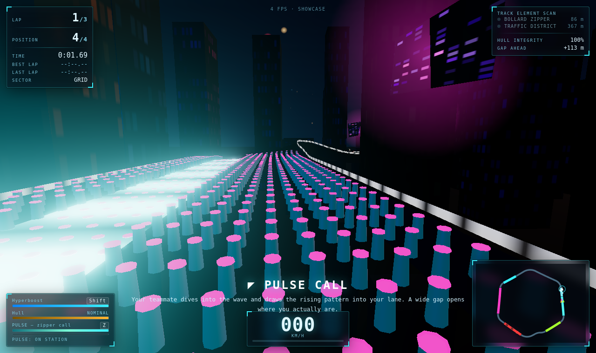
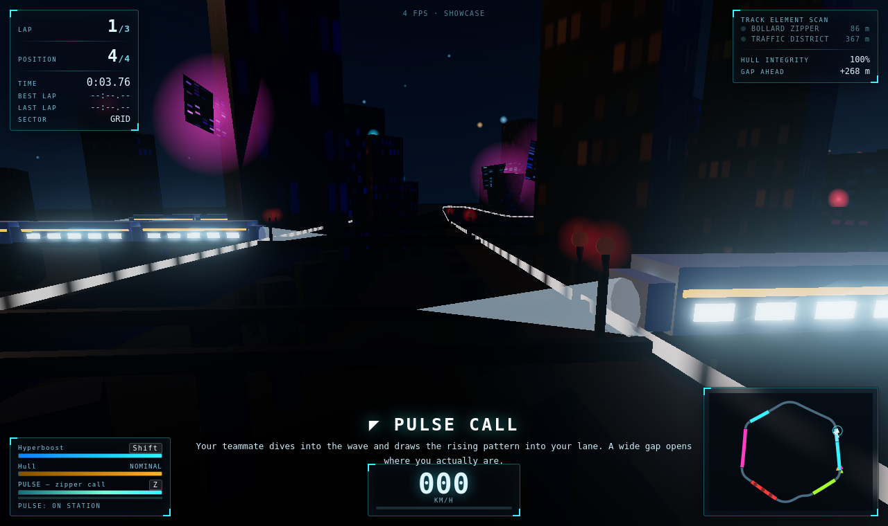
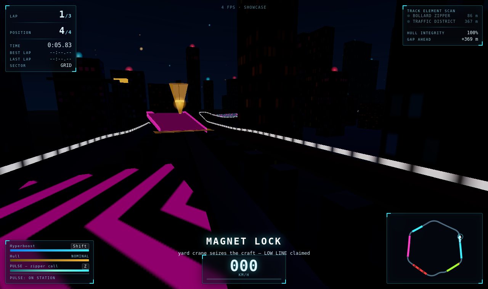

# SPINE RUNNER

An anti-gravity racing game in the browser — *WipEout* meets the *Ready Player One*
race, built around a circuit whose identity comes from **dynamic track elements**
rather than static geometry.

Three laps of the **Neo-Kowloon Spine**: 2.27 km of elevated quarantine highway
that threads a bollard field, a maglev yard, a traffic district and a container
crane port. Race three rival pilots, or ride the flythrough and watch the
machinery work.

## Run it

```bash
npm install
npm run dev          # build the bundle, then serve http://localhost:8080
```

Other scripts:

| script | what it does |
| --- | --- |
| `npm run build` | bundles `src/main.js` → `public/js/spine.js` (esbuild, ~150 ms) |
| `npm run watch` | rebuild on change |
| `npm start` | serve `public/` on `0.0.0.0:8080` (`PORT` / `HOST` env override) |

The built bundle is committed, so `npm start` alone runs the game from a fresh
clone. Only `three` is needed at runtime.

## Controls

| input | action |
| --- | --- |
| `A` / `D`, `←` / `→` | steer |
| `Q` / `E` (or airbrake buttons) | airbrake, hard rotation |
| `W` / `↑` | throttle · `S` / `↓` brake |
| `Shift` | hyperboost (drains energy, recharges off-throttle) |
| `Z` | **PULSE** — call your zipper teammate |
| `P` `R` `C` `M` `H` `B` | pause · restart · camera · mute · HUD · bloom |
| gamepad | supported (left stick, triggers, A/B) |





## The four dynamic elements

1. **Bollard zipper** — an entire avenue of bollards rises in a travelling wave
   (`s`-phase + time), leaving one sliding open corridor. Brushing a raised post
   costs hull and speed, so the wave is a timed slalom — read the corridor,
   thread it. **PULSE** (`Z`) sends a teammate into the wave: the pattern
   redraws around *your* lateral position, opening a wide gap where you actually
   are (2.6 s window, 8.5 s cooldown).
2. **Maglev crossings** — three freight lines cross the deck perpendicular to
   racing. Random staggered clocks, amber warn, red lock. The sweep is honest:
   a consist is a long body laid across the deck, and it is only dangerous while
   it is actually on your line. The scan panel shows the state and time-to-danger.
3. **Traffic district** — thirteen municipal hover vehicles, two lanes running
   *oncoming*, heavy contact shoves you sideways.
4. **Magnetic cranes** — the Y and T splits. A yard crane swings its field
   between two claimed lanes; drive into the cone and the magnet seizes the
   craft: lift, carry, throw (~+34% launch speed), or fight it with airbrakes to
   break the lock and stay on your line.
   * Y fork (crane yard): TWO LANES split around a divider island.
   * T split: a HIGH LINE flyover crane throws you onto the raised skyway, or
     you stay low and boost out of the exit.

Track layout, anchors, zones and the closure solve are all in `src/track.js`
(`npm run build && node tools/verify-track.mjs` prints the audit).

## Project layout

```
public/index.html      shell, HUD markup + CSS, minimap canvas
public/js/spine.js     build output (committed so the app runs unbuilt)
src/config.js          tuning constants (speed, grip, damage, boost)
src/track.js           LAYOUT v2, closure solve, Deck sampling + projection
src/ship.js            Vehicle / PlayerShip, trails, damage, respawn
src/hazards.js         Sparks, Zipper, TrainLine, Traffic, Crane, Hazards
src/ai.js              solveRacingLine() + RivalShip (braking, weaving, trains)
src/race.js            session machine: countdown, laps, results, PULSE
src/city.js            procedural skyline
src/hud.js             HUD binding, minimap, banners, results
src/main.js            renderer, camera rig, flythrough tour, frame loop
tools/                 build, serve, and the two test harnesses
```

## Tests

```bash
node tools/soak.mjs 240      # headless LOGIC soak: autopilot race, invariants
node tools/verify-track.mjs  # track geometry audit (closure, kinks, anchors)
node tools/smoke.mjs         # browser smoke + screenshots (needs chromium deps)
```

`tools/soak.mjs` is the primary harness: it drives the simulation at a fixed
1/60 dt with an autopilot, then reports NaNs, wrecks, hull hits by cause, stall
frames and their track buckets, lift counts, lap times and finish order — so
physics and hazard-fairness regressions surface in seconds instead of needing
real-time play.

`tools/smoke.mjs` needs a chromium binary; in a bare container install
`@sparticuz/chromium` and `puppeteer-core` and point `LD_LIBRARY_PATH` at the
extracted libs (see the script header).
