# Level 01 / Section 1 - Fractured Town (greybox)

A point-to-point racing section through a town that has come apart and is hanging in the
air. Roads, roofs, a house floor, a bridge, a market square and a church nave form one
drivable line through the wreckage, and that line moves while you drive it.
The section ends in a portal that carries you, at speed, to Section 2 in another part of the
same map.

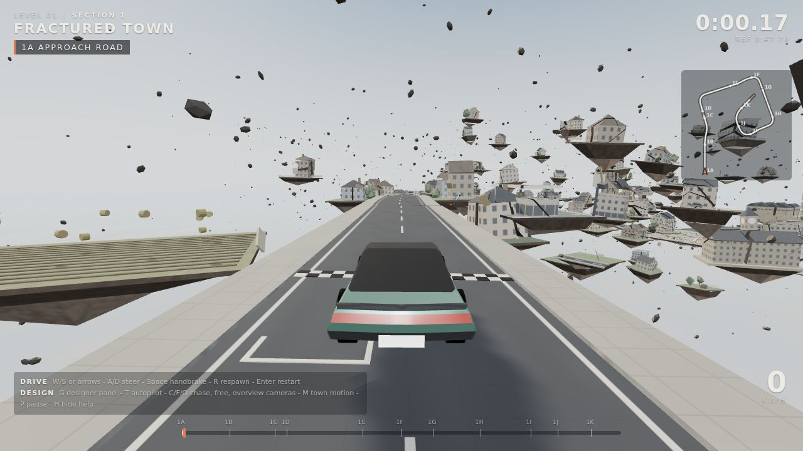

| | |
|---|---|
| Length | **1,471 m**, point-to-point, 11 beats |
| Reference time | **47.6 - 47.9 s** (autopilot, every motion phase tested), first runs will be slower |
| Speeds | 0 - 168 km/h, 111 km/h average for the autopilot |
| Air | ~8 s of airtime per run, longest single jump ~1.7 s |
| World | 2,101 moving bodies, 1,635 convex colliders, ~420 loose props, ~153k triangles |
| Exit | stone gateway portal to Section 2, a placeholder 2.4 km away in the same world |

## Run it

```bash
npm install
npm run dev            # http://localhost:5173
npm test               # headless autopilot run + joint audit (no browser needed)
node tools/export-map.mjs   # regenerate the plan/profile drawings below
```

| Drive | |
|---|---|
| W / S or arrows | throttle / brake, hold S to reverse |
| A / D | steer |
| Space | handbrake (drift) |
| R / Enter | respawn at last marker / restart the section |
| Gamepad | RT/LT, left stick, A handbrake, Y respawn |

| Design | |
|---|---|
| G | designer panel: teleport to any beat, toggles, live stats |
| T | autopilot demo run |
| C / F / O | chase, free-fly (WASD+QE, drag to look, Shift fast), overview orbit |
| M | freeze / resume the town's motion |
| [ ] | time scale |
| URL | `?designer` `?auto` `?clean` `?overview` `?nocountdown` `?q=medium` / `?q=low` |

## How the brief became the level

| Brief | What is in the build |
|---|---|
| Separate level, greybox | Level 01 is its own build (`index.html` > `src/main.js` > `src/level/level01.js`). Procedural greybox shader: 1 m / 4 m grid, window bays per floor, road paint, tile and masonry courses. No textures or models apart from the car. |
| Floating town, no gravity | Every piece floats: road slabs, garden plots with their torn soil underneath, fractured houses, shops, a supermarket, a terrace, a water tower, a mill, a factory chimney, the church. Furniture and street props drift and tumble. Rubble hangs in the air. |
| Debris, cracks, fractured buildings, buildings move slightly | Buildings are sliced into convex chunks that ride their plot and drift slightly apart. Cracks open and close; plots bob and tilt. |
| Fracture | Pre-fractured everything, **plus** slabs that crumble apart behind you, a plaster wall you burst through, breakable market stalls. Toggle in the designer panel. |
| Drivable path from buildings, roofs, roads, fragments | Road slabs, a supermarket roof, three shop roofs, a 15° pitched terrace roof, a house's first floor, bridge spans, raft-like plaza tiles, a church nave. |
| Path moves naturally, not forced | The whole town rides one slow "swell" field (see Motion). Neighbouring pieces move together, so the line stays drivable without anything being scripted or looped. |
| At least 30 s | 1,471 m. Autopilot 47.7 s; a human will be slower. |
| Not a track, no laps | Point-to-point from the start line to the portal. |
| Checkpoints are portals within the same map | The exit portal carries the car, keeping speed and heading, to Section 2: another part of the same world, not a level load. The gateway shows the destination live through it. |
| Ready Player One feel, no neon / cyberpunk | Big, physical spectacle: an ordinary town torn apart, in daylight and haze. The portal is a plain stone gateway you can see through. No glow, no synthwave, no gimmicks. |

## Beat sheet

The line is a clockwise inward spiral. You see the church spire (the finish) from the first
metre, circle the town on its outskirts and roofs, and finish by climbing into its heart.
Heights are absolute; the town hangs 15 - 52 m above the cloud floor.

| Beat | Length | You drive on | What happens | Design notes |
|---|---|---|---|---|
| **1A Approach Road** | 160 m | intact road, cracking | Start line, the whole town laid out ahead and right | Calm launch, the reveal. Long slabs, hairline cracks. Gas station and a farm field float past. |
| **1B Broken High Street** | 150 m | road slabs | Cracks become gaps and step-downs; some slabs rock; houses on torn plots either side | A collapsed house blocks the straight line, so the street bends left (R≈88 m). That bend also governs the kicker's entry speed. |
| **1C The Kicker** | 40 m | snapped slab ramp, 5° then 9° | ~24 m leap down onto the supermarket roof | Entry 25 - 37 m/s lands 30 - 52 m out. The roof is sized from that envelope. |
| **1D Rooftops** | 256 m | supermarket roof, 3 shop roofs, pitched terrace roof | Turn right *on* the roof; three hop-downs; a 66 m run along a 15° roof slope; drop into the lane | Parapets catch overshoots. The pitched roof is banked from its first metre; chimneys stand on the ridge. |
| **1E Mill Lane** | 128 m | road slabs | Under the snapped water tower, past the mill and its turning wheel | Crumbling slabs; an S through cottages. |
| **1F The House** | 107 m | crossroads slab, then a townhouse floor | Turn south, burst through the plaster wall inside the house, out the back and down 5 m | The top storey is torn off and hovers 8 m up, so the chase camera never clips. Furniture drifts in the rooms. |
| **1G River Bridge** | 158 m | river road, 3 stone bridge spans | Up span 1 and jump; span 2 drifts sideways; drop to span 3 | Span 2 is 40 m long to catch 15 - 40 m/s jumps. The river hangs below in pieces. |
| **1H South Street** | 170 m | road slabs | Turn west; a bus hangs across the pavement; shops both sides | Fast section between two tight corners. |
| **1I Market Square** | 90 m | 48 paving tiles | Curve north across the square, past the broken fountain and stalls | Tiles tilt like rafts on the swell. The town hall and its clock tower frame the turn. |
| **1J Church Hill** | 112 m | cracked slabs climbing ~8° | A climbing right-hander that swings the church door into view square-on | Deliberately continuous, with no hops. You can't steer in the air, and an earlier version with hops failed the tests. |
| **1K The Church** | 100 m | nave floor, chancel steps | In through the tower door, down the nave through drifting pews, up the chancel and out through the blown-open apse: the leap into the portal | Gate height sized so ~22 - 40 m/s leaps make the opening. |

Plan view (north up, 50 m grid; generated from the level data by `tools/export-map.mjs`):

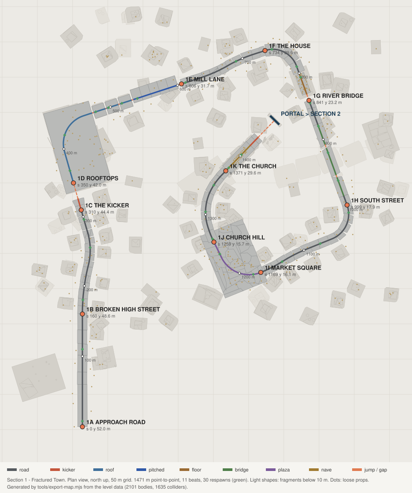

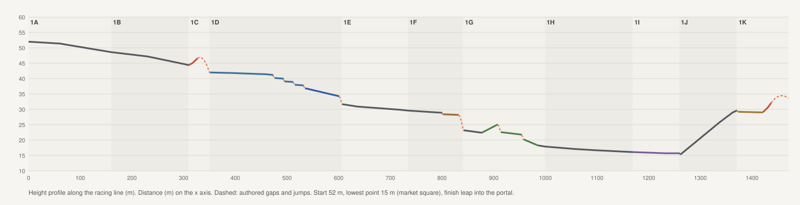

| | |
|---|---|
| 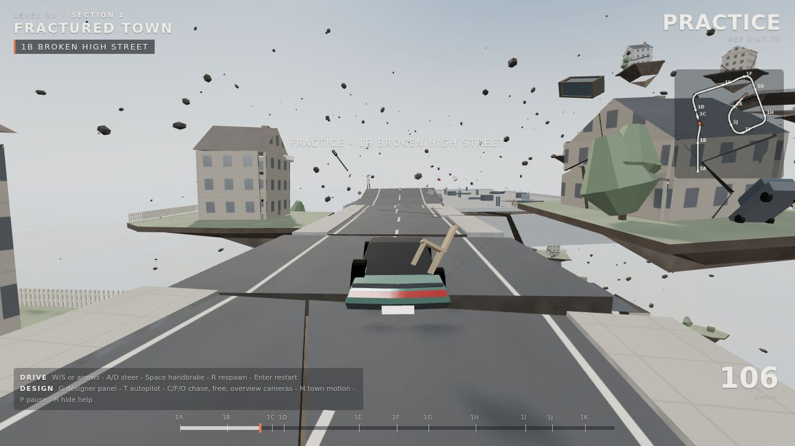 | 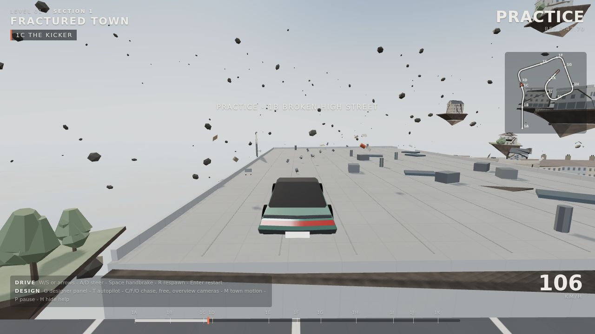 |
| 1B - broken high street | 1C - the kicker onto the supermarket roof |
| 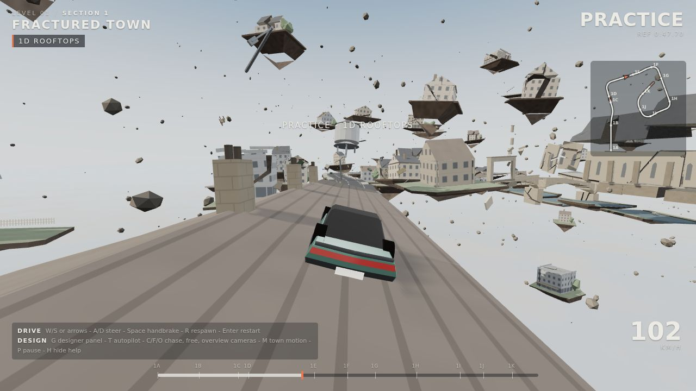 | 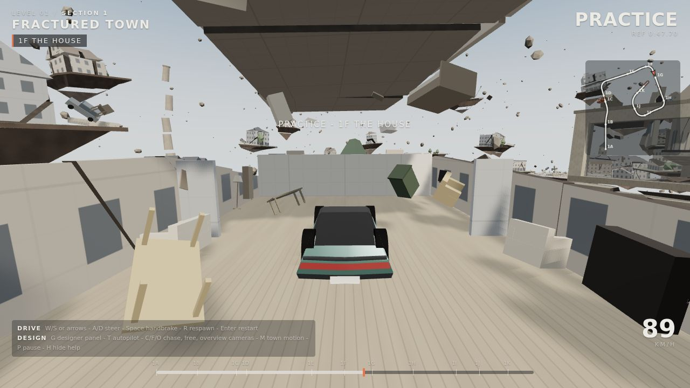 |
| 1D - 15° pitched terrace roof | 1F - through the split townhouse |
| 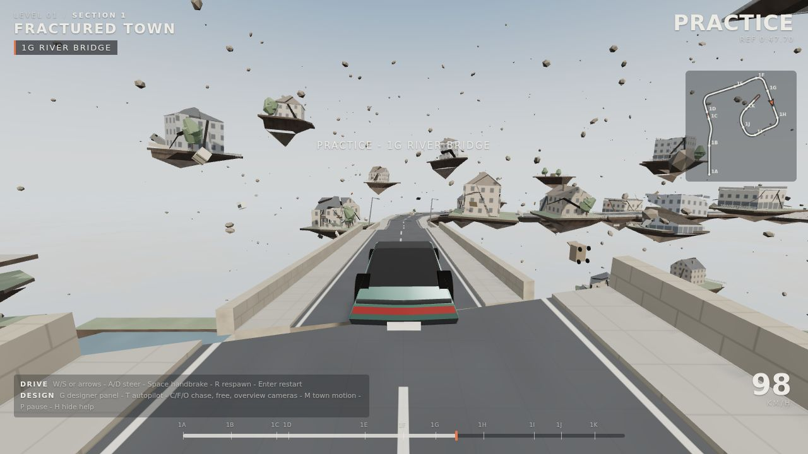 | 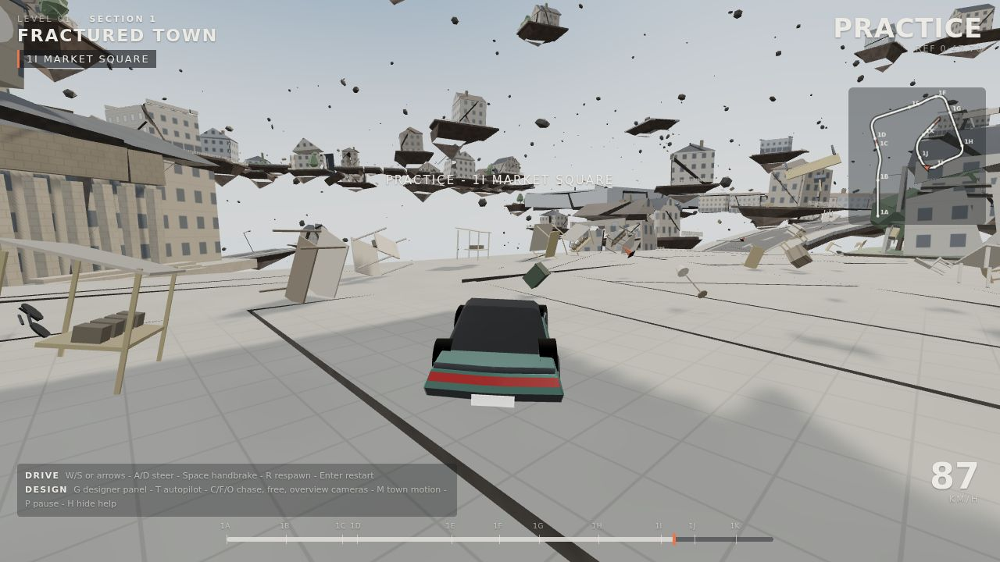 |
| 1G - the river bridge | 1I - market square |
| 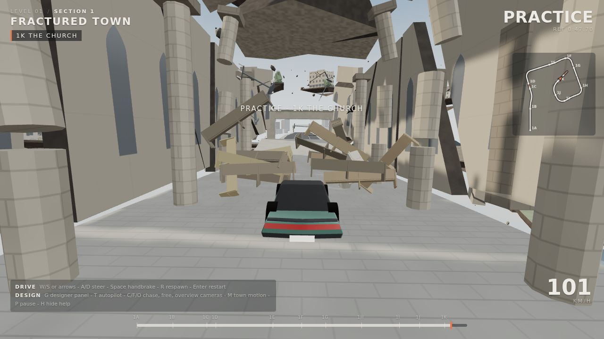 | 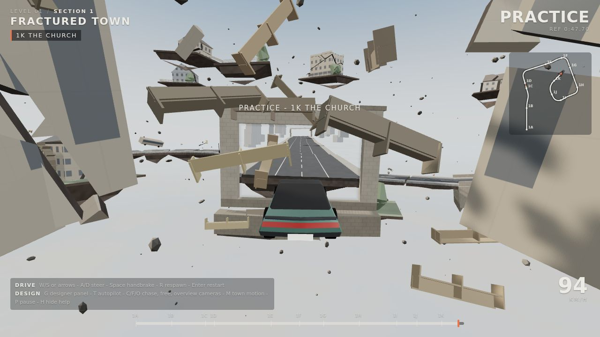 |
| 1K - the nave | 1K - the leap into the portal |

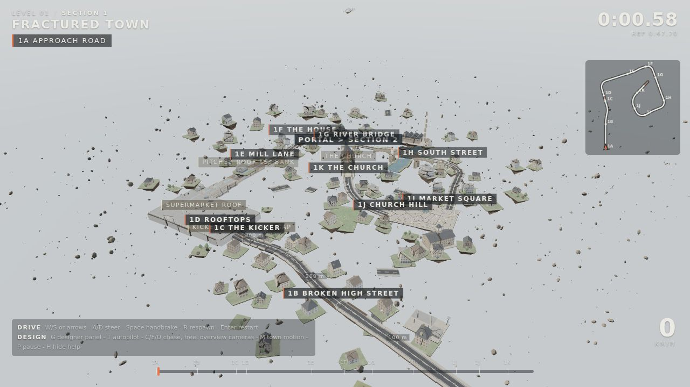

## Motion: how the path moves without breaking

Everything rides **the swell**: three slow travelling waves (periods 9.7 - 17.3 s,
wavelengths 105 - 230 m, ±1.46 m combined). Each fragment samples the field across its own
footprint and takes the resulting height and tilt, like a raft. Two slabs either side of a
crack sample almost the same field, so they rise and tilt together. That is what keeps a
broken road drivable while the whole town heaves. The periods don't share a common beat,
so the motion never visibly loops.

On top of the swell:
- Route pieces get tiny roll and yaw wobble, never pitch, so the line at a joint is governed by
  the swell alone. Selected slabs rock ±2.5° in 1B, 1E and 1H. Bridge span 2 drifts ±1.3 m
  sideways.
- Scenery breathes more: plots bob up to ±1.1 m and tilt up to ~2°, building chunks drift
  apart and back, props tumble.
- Route pieces match the field exactly at their two ends, where the joints are.

Joint rules enforced by the builders:
1. Every crack is a single plane shared by both slabs, so the edges are parallel.
2. A joint always steps **down**, never up, sized against the local grade.
3. Jumps land on long, lower surfaces.

`tools/audit-route.mjs` raycasts the real moving colliders along the line, at the centre and
±3 m, every 0.5 m, for 90 - 120 s of motion:

```
audited 120s of motion @0.5s, 2,127,066 raycasts
joints crossed on the centre line: 90; joint height variation over time: mean 8 cm, max 23 cm
worst step-up anywhere (incl. +-3 m): 14.3 cm (limit 15 cm)
PASS: every joint stays drivable through the motion
```

## Fracture

- **Pre-fractured world.** Convex plane slicing (`src/core/fracture.js`). Chunks keep their
  facade, tile and road patterns in building space, so a cracked facade still reads as one
  facade. Fresh cut faces are darker.
- **Crumbling slabs.** Selected slabs in 1B, 1E and 1H break into pieces and drift apart about
  7 m after you leave them. They re-form if you respawn behind them.
- **Breakables.** The plaster wall in the house shatters into 14 shards; market stalls break.
- Everything is reset by Restart. The **Fracture** toggle disables crumbling and breaking.

## Verification

`npm test` runs both checks:

- `tools/headless-run.mjs` builds the level in Node and lets the autopilot drive at a fixed
  120 Hz through the portal into Section 2. Results:
  - Motion phases 0, 7, 13, 19, 25, 33, 51, 77, 90, 120, 200 and 333 s: completed in 47.6 - 47.9 s,
    **0 respawns**.
  - Same with motion frozen, and with fracture off.
  - Typical run: 168 km/h max, 111 km/h average, ~8 s of air, 32 props hit, 2 breaks, 5 crumbles.
- `tools/audit-route.mjs`: see Motion above.

## Greybox conventions

| Colour / pattern | Meaning |
|---|---|
| Dark grey asphalt + paint | road surface (markings run in route space) |
| Light grey grid, membrane seams | drivable flat roof |
| Warm grey with tile courses | pitched roof |
| Off-white with dark window bays | facades (3 m floors; shopfront, church and warehouse variants) |
| Dark mottled faces | fresh fracture |
| Brown underside | torn earth under plots and slabs |
| Pale ochre / beige | loose props: they will move if you hit them |
| Stone courses | bridge, church, portal gateway |

## Code map

```
src/core/      rng, geo (mesh builder + surface kinds), fracture (convex slicing),
               motion (swell / wobble / parents), world (bodies, colliders, queries),
               route (turtle-authored line), vehicle (arcade rigid body), autopilot
src/level/     ctx (frames, corridor keep-out), kit/ (road, buildings, props),
               section1/ (route1 = beat sheet, structures = set pieces, dressing, index),
               section2 (placeholder), level01 (assembly + portal link)
src/render/    greybox shader, BatchedMesh level view + overlay, environment, car, portal view
src/game/      race logic (progress, splits, crumble, respawn, portals), input, cameras, HUD
tools/         headless-run, audit-route, export-map
```

Tuning lives where you would look for it:
- Beat lengths, heights and banking: `section1/route1.js`.
- Slab sizes, gaps and crumble rates: per beat in `section1/index.js`.
- Swell strength: `core/motion.js`.
- Handling: `CAR` in `core/vehicle.js`.

## Open questions and next steps

- **Section 2.** It is a neutral placeholder runway. Its world, theme and route are yours to
  pick; the portal link already works.
- **Opponents.** The level is laid out 14 m wide for pack racing. AI cars could reuse the
  autopilot with offsets.
- **Car scale.** The ControlVehicle mesh is 6.2 m long. The level is built around that (14 m
  roads, 12 - 16 m interiors). If the car is rescaled, the interior widths could shrink.
